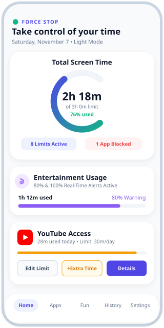
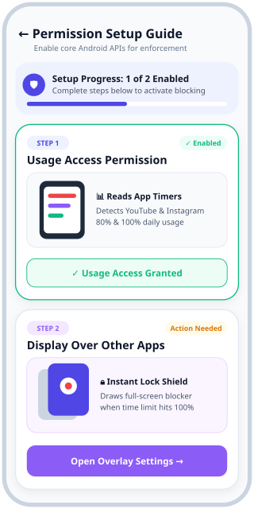
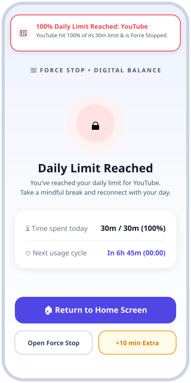

# 🛑 Force Stop — Android Digital Wellbeing & Strict Screen Time Control

> **“Take control of your screen time.”**  
> A modern, offline-first Android Digital Wellbeing and App Usage Control application built with **Kotlin**, **Jetpack Compose (Material 3)**, and **Room Database**.

---

## 📱 App Preview Screens

<p align="center">
  
  &nbsp;&nbsp;&nbsp;
  
  &nbsp;&nbsp;&nbsp;
  
</p>

| **1. Wellbeing Dashboard (Light UI)** | **2. Illustrated Permission Guide** | **3. 100% Limit Lock & Notification** |
| :---: | :---: | :---: |
| Circular usage gauge, Entertainment budget progress, and dedicated YouTube spotlight. | Step-by-step interactive onboarding with vector illustrations for Usage Access & Overlay APIs. | Real-time 80% / 100% notifications and full-screen interception when daily time expires. |

---

## ✨ Key Features

### 1. 📊 Real-Time Wellbeing Dashboard
- **Circular Screen Time Gauge:** Speedometer-style progress ring showing today's total screen time, percentage used, and remaining budget.
- **Entertainment Control Summary:** Tracks combined usage across video, social media, and gaming apps.
- **Dedicated YouTube Access Card:** Monitor YouTube usage, daily limit, remaining minutes, and extra-time grants directly from the home screen.

### 2. 🔔 Foreground Service with 80% & 100% Real-Time Notifications
- **`UsageMonitorService` (`foregroundServiceType="specialUse"`):** Continuously monitors foreground app activity via `UsageStatsManager` every 3 seconds.
- **80% Entertainment Limit Alert:** Sends a high-priority local notification when any entertainment app (or the combined Entertainment budget) reaches **80%** of its daily allowance.
- **100% Daily Limit Reached Alert:** Triggers an immediate **100% Limit Reached** notification and launches the full-screen blocker (`BlockedAppActivity`) the moment an app exhausts its allowance.
- **10m & 5m Countdown Warnings:** Optional gentle nudges before an app is restricted.

### 3. 🖼️ Illustrated Permission Setup Screen (`PermissionsSetupScreen`)
- Interactive step-by-step onboarding screen explaining **why** each Android system permission is required:
  - **Step 1 — Usage Access (`PACKAGE_USAGE_STATS`):** Custom animated illustration showing how Force Stop reads app timers (`30m / 30m → Trigger`).
  - **Step 2 — Display Over Other Apps (`SYSTEM_ALERT_WINDOW`):** Custom animated illustration showing how the lock shield covers distracting apps when their limit hits 100%.
- Automatic status refresh via `Lifecycle.Event.ON_RESUME` when returning from Android System Settings.

### 4. 🔒 Strict App Blocking & Bypass Protection
- **Full-Screen Interception (`BlockedAppActivity`):** Prevents continued usage of restricted apps until the next daily reset cycle (`12:00 AM` default, customizable in Settings).
- **Strict Lockdown Mode:** Completely disables extra-time requests when enabled.
- **4-Digit PIN Passcode:** Protects limit changes, restriction toggles, and extra-time approvals.

### 5. 📈 7-Day Usage History & Local Persistence
- Interactive **7-Day Screen Time Pattern** bar chart with violation indicators.
- 100% local, offline-first **Room Database** (`AppLimitConfig`, `DailyUsageSnapshot`, `AppSettingEntity`)—no cloud accounts or external tracking.

---

## 🛠️ Tech Stack & Architecture

- **Language:** 100% Kotlin
- **UI Framework:** Jetpack Compose, Material Design 3 (Light & Dark Themes), Custom `Canvas` Gauges & Illustrations
- **Architecture:** MVVM (`MainViewModel` + `StateFlow` + `ForceStopRepository`)
- **Database:** Room Persistence Library (KSP)
- **Android System APIs:**
  - `UsageStatsManager` & `UsageEvents` (`ACTIVITY_RESUMED`)
  - `Settings.ACTION_USAGE_ACCESS_SETTINGS` & `Settings.ACTION_MANAGE_OVERLAY_PERMISSION`
  - Foreground Service (`UsageMonitorService`) + `NotificationCompat` Channels

---

## 🚀 Building & Running the Project

1. Clone this repository or export directly from **Google AI Studio**:
   ```bash
   git clone https://github.com/<your-username>/force-stop-digital-wellbeing.git
   cd force-stop-digital-wellbeing
   ```
2. Open in **Android Studio Ladybug (or newer)** and run on a device or emulator (API 24 – 36).
3. In the app, tap the **"Enable Usage & Overlay Permissions"** banner on the Home screen to open the **Illustrated Permission Setup Guide**, or test the alerts immediately via **Settings → Test 80% Alert / Test 100% Alert**.
